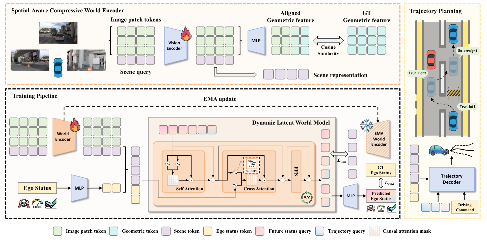
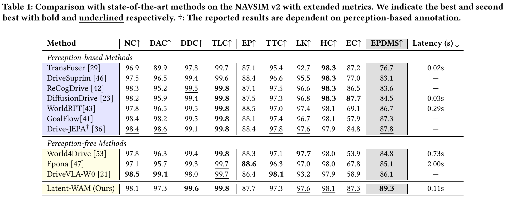
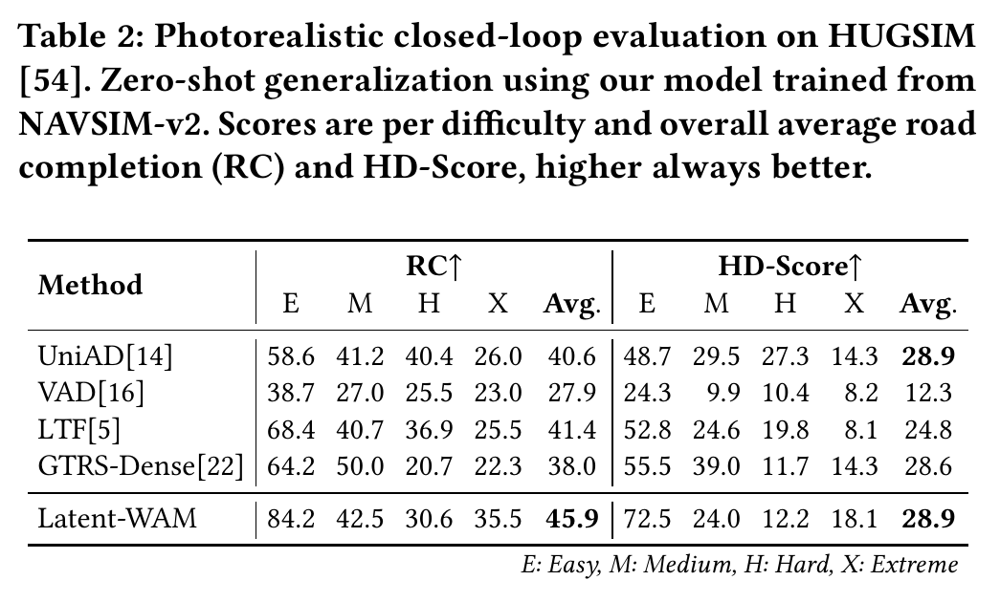

# Latent WAM：面向端到端自动驾驶的潜在世界动作建模

**已被 ACM MM 2026 接收（Poster）。**

[论文](https://arxiv.org/abs/2603.24581) ·
[ModelScope 权重](https://modelscope.cn/models/Jinhsi555/Latent-WAM) ·
[English](README.md)

Linbo Wang, Yupeng Zheng, Qiang Chen, Shiwei Li, Yichen Zhang, Zebin Xing, Qichao Zhang, Xiang Li,
Deheng Qian, Pengxuan Yang, Yihang Dong, Ce Hao, Xiaoqing Ye, Junyu Han, Yifeng Pan, Dongbin Zhao

Latent WAM 在紧凑的潜在空间中学习空间结构与未来动态，用于端到端自动驾驶。
推理时仅使用当前三路相机图像和自车状态，预测未来 4 秒轨迹，无需 WorldMirror 或未来世界 rollout。

## 方法



**空间感知压缩世界编码器（SCWE）**通过几何知识蒸馏生成紧凑的场景 token；
**动态潜在世界模型（DLWM）**在训练阶段学习未来场景与自车动态，增强轨迹解码器所使用的表征。

## 实验结果

以下结果直接截取自论文：NAVSIM v2 **89.3 EPDMS**，HUGSIM **45.9 RC / 28.9 HD-Score**。
当前仓库提供 NAVSIM 实现与评测流程。

### NAVSIM v2



### HUGSIM



## 快速上手

### 1. 安装

支持环境：Linux、Python 3.10、PyTorch 2.4.1、CUDA 12.4。

```bash
git clone --recurse-submodules https://github.com/Jinhsi555/Latent-WAM.git latent-wam
cd latent-wam
conda env create -f environment.yml
conda activate latent-wam
pip install -e .

export NAVSIM_DEVKIT_ROOT="$PWD"
export PYTHONPATH="$NAVSIM_DEVKIT_ROOT${PYTHONPATH:+:$PYTHONPATH}"
export OPENSCENE_DATA_ROOT="/path/to/dataset"
export NAVSIM_EXP_ROOT="/path/to/experiments"
export NUPLAN_MAPS_ROOT="$OPENSCENE_DATA_ROOT/maps"
export NUPLAN_MAP_VERSION="nuplan-maps-v1.0"
```

### 2. 准备数据

使用 [download/](download/) 下的脚本下载 nuPlan 地图和 NAVSIM 测试集，按以下目录组织：

```text
dataset/
├── maps/
├── navsim_logs/test/
└── sensor_blobs/test/
```

下载命令及训练数据准备见[数据准备文档](docs/latent_wam/usage_zh.md#准备-navsim-数据)。

### 3. 下载权重

```bash
pip install modelscope
python - <<'PY'
from modelscope import snapshot_download
snapshot_download("Jinhsi555/Latent-WAM", local_dir="models/latent-wam")
PY
export LATENT_WAM_CHECKPOINT="$NAVSIM_DEVKIT_ROOT/models/latent-wam/model.safetensors"
```

DINOv2-Base 默认从 Hugging Face 自动下载。离线使用时设置
`export DINOV2_PATH=/path/to/dinov2-base`。评测不需要 WorldMirror。

### 4. 评测

先生成一次 metric cache，再运行 GPU 批量推理与 CPU 并行评分：

```bash
python navsim/planning/script/run_metric_caching.py \
  train_test_split=navtest \
  metric_cache_path="$NAVSIM_EXP_ROOT/metric_cache"

EVALUATION_DEVICES=0 PDM_WORKERS=8 INFERENCE_BATCH_SIZE=32 \
  bash scripts/evaluation/run_latent_wam_epdms_parallel.sh
```

多 GPU 设置 `EVALUATION_DEVICES=0,1`，batch size 按显存调整。
追加 `--max-scenarios 100` 可进行小规模测试；默认启用 human-penalty filter。
结果保存至 `$NAVSIM_EXP_ROOT/latent_wam_eval/navtest.csv`，
EPDMS 为 `average_all_frames` 行的 `score × 100`。

## 训练

训练需要 NAVSIM trainval、DINOv2-Base，以及用于生成几何缓存的 WorldMirror。
默认将 train 和 val 合并训练 100 个 epoch，使用 8 节点 × 8 卡、每卡 batch 8、无梯度累积
（global batch 512）、BF16、global 缓存采样和块下三角 `block_causal` 时序 attention。
学习率峰值为 `2e-4`，最终衰减到 `1e-6`；
每轮监控 5 个验证 batch，每 5 个 epoch 保存 checkpoint。
具体命令见[缓存生成与训练](docs/latent_wam/usage_zh.md#从头训练-latent-wam)。

更多文档：
[安装](docs/latent_wam/installation.md) ·
[完整使用指南](docs/latent_wam/usage_zh.md) ·
[训练细节](docs/latent_wam/training.md) ·
[缓存格式](docs/latent_wam/cache-format.md)

## 引用

```bibtex
@article{wang2026latentwam,
  title={Latent-WAM: Latent World Action Modeling for End-to-End Autonomous Driving},
  author={Wang, Linbo and Zheng, Yupeng and Chen, Qiang and Li, Shiwei and Zhang, Yichen and
          Xing, Zebin and Zhang, Qichao and Li, Xiang and Qian, Deheng and Yang, Pengxuan and
          Dong, Yihang and Hao, Ce and Ye, Xiaoqing and Han, Junyu and Pan, Yifeng and Zhao, Dongbin},
  journal={arXiv preprint arXiv:2603.24581},
  year={2026}
}
```

## 致谢与许可证

感谢 [NAVSIM](https://github.com/autonomousvision/navsim)、
[nuPlan](https://github.com/motional/nuplan-devkit)、
[DINOv2](https://github.com/facebookresearch/dinov2) 和
[WorldMirror](https://github.com/Tencent-Hunyuan/HunyuanWorld-Mirror)。

NAVSIM 衍生代码采用 Apache-2.0。WorldMirror 使用独立的 Tencent HunyuanWorld-Mirror Community
License Agreement，并包含额外限制。使用前请阅读 [NOTICE](NOTICE)、
[THIRD_PARTY_LICENSES.md](THIRD_PARTY_LICENSES.md) 和
[WorldMirror 许可证](worldmirror/License.txt)。
