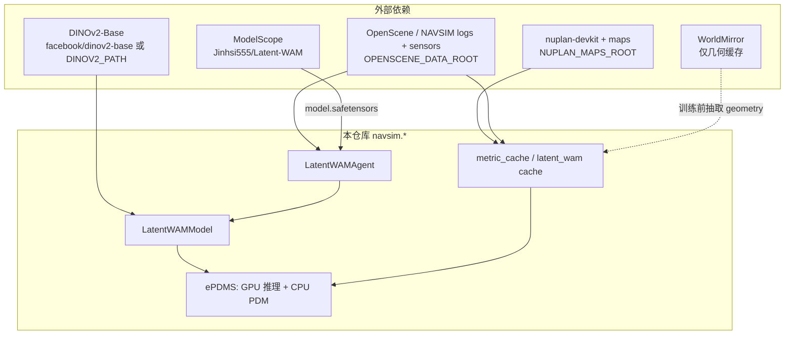
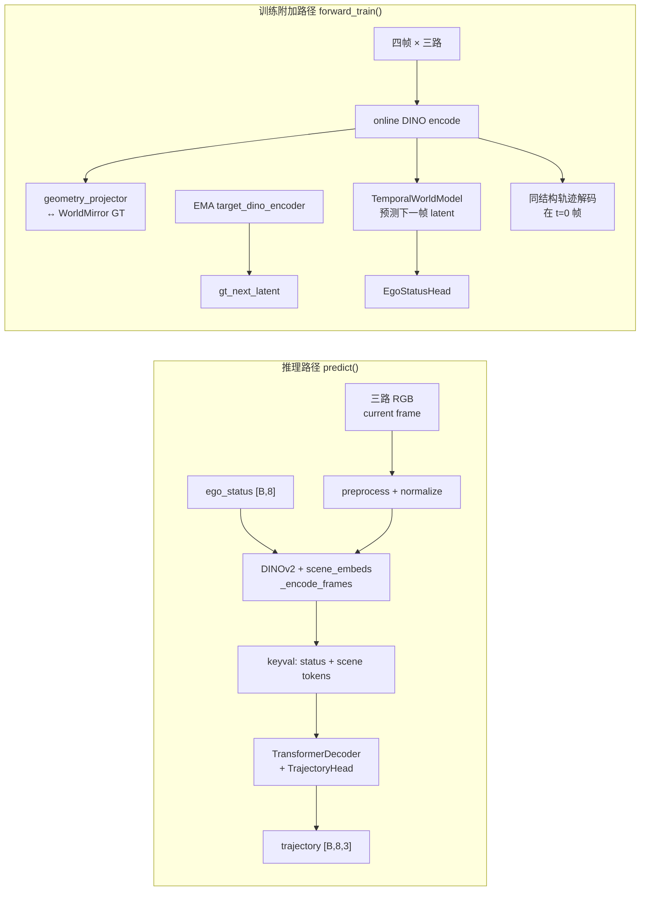
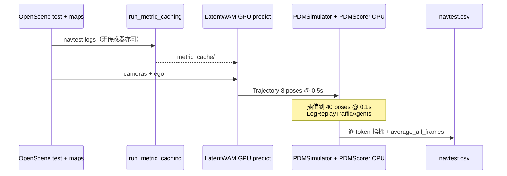

# Latent WAM 代码库技术分析

> 基于公开 fork [`suyunhuan/Latent-WAM`](https://github.com/suyunhuan/Latent-WAM) 实勘（commit `504508a`，与上游 tip 一致）。  
> 本文是项目内部 handbook：把仓库结构、模型、训练、NAVSIM ePDMS 评测与本团队 AutoDL 实测串起来，便于后续云训练与架构调研。  
> 关联文档：[推理 Runbook](runbook-navisim-inference.md) · [AutoDL 状态](autodl-bootstrap-status.md) · [Case 可视化清单](media/epdms-case-viz/manifest.json) · [本目录索引](README.md)

---

## 1. 仓库总览

### 1.1 一句话定位

Latent WAM（Latent World Action Modeling）是端到端自动驾驶规划研究代码：**在潜在空间学习空间结构与未来动态**，推理时只用**当前三路 RGB 相机 + 自车状态**，输出未来 **4 秒 / 8 个位姿**的轨迹。发布权重在 NAVSIM v2 一阶段 ePDMS 上论文报 **89.3**；本团队 AutoDL 全量复现约为 **89.34**（见 §5）。

仓库以 **NAVSIM 布局 fork** 形式交付：Python 包名是 `latent-wam`，安装后导入的是 `navsim.*`。WorldMirror（`worldmirror/` 子模块）**仅用于训练几何缓存**，正式推理/评测不加载。

### 1.2 顶层目录

| 路径 | 作用 |
| --- | --- |
| `navsim/agents/latent_wam/` | **核心模型**：config / model / agent / Lightning / cache / features |
| `navsim/agents/latent_wam/modules/` | `TemporalWorldModel`、RoPE attention |
| `navsim/evaluate/latent_wam_epdms.py` | 一阶段 ePDMS 评测库（单进程路径调用） |
| `navsim/planning/script/` | Hydra 入口：metric cache、caching、training、PDM score |
| `navsim/visualization/` | BEV / 相机帧绘图（case viz 所用） |
| `scripts/evaluate_latent_wam_epdms*.py` | 官方评测 CLI（单进程 / 多卡并行） |
| `scripts/evaluation/run_latent_wam_epdms_parallel.sh` | README Quick Start 启动器 |
| `scripts/training/run_latent_wam_training_multi_node.sh` | 多节点训练启动器 |
| `scripts/validate_latent_wam_checkpoint.py` | 严格权重加载 + 合成样本 `predict` smoke |
| `download/` | maps / mini / trainval / test / navtrain 下载脚本 |
| `docs/latent_wam/` | 权威安装、用法、训练、缓存格式文档 |
| `worldmirror/` | HunyuanWorld-Mirror 子模块（训练几何监督） |
| `environment.yml` | Conda：Python 3.10、PyTorch 2.4.1、CUDA 12.4 |
| `tests/latent_wam/` | CPU 侧配置 / cache / checkpoint 测试 |

### 1.3 与 NAVSIM / NuPlan / DINOv2 / WorldMirror 的依赖关系



**环境变量（Hydra / 脚本约定）：**

| 变量 | 含义 |
| --- | --- |
| `NAVSIM_DEVKIT_ROOT` | 仓库根目录 |
| `OPENSCENE_DATA_ROOT` | 数据根：`maps/`、`navsim_logs/`、`sensor_blobs/` |
| `NAVSIM_EXP_ROOT` | 实验根：metric cache、训练 cache、评测 CSV |
| `NUPLAN_MAPS_ROOT` / `NUPLAN_MAP_VERSION` | 通常 maps 目录 + `nuplan-maps-v1.0` |
| `LATENT_WAM_CHECKPOINT` | `model.safetensors` 或兼容 `.ckpt` |
| `DINOV2_PATH` / `WORLD_MIRROR_PATH` | 可选本地快照 |

### 1.4 主要入口脚本（按用途）

| 用途 | 入口 |
| --- | --- |
| Checkpoint smoke（无 NAVSIM 场景） | `scripts/validate_latent_wam_checkpoint.py` |
| Metric cache（评测一次） | `navsim/planning/script/run_metric_caching.py` |
| ePDMS 单进程 | `scripts/evaluate_latent_wam_epdms.py` |
| ePDMS 并行（推荐） | `scripts/evaluation/run_latent_wam_epdms_parallel.sh` |
| 训练几何/图像缓存 | `navsim/planning/script/run_latent_wam_caching.py` |
| 多节点训练 | `scripts/training/run_latent_wam_training_multi_node.sh` → `run_training.py` |
| `.ckpt` → safetensors | `scripts/convert_latent_wam_checkpoint.py` |

Agent Hydra 配置：`navsim/planning/script/config/common/agent/latent_wam_agent.yaml`。

---

## 2. 模型结构

代码集中在 `navsim/agents/latent_wam/`。顶层类：

| 类 | 文件 | 职责 |
| --- | --- | --- |
| `LatentWAMConfig` | `config.py` | 强类型配置（vision / geometry / transformer / trajectory / losses / data / training） |
| `LatentWAMModel` | `model.py` | DINOv2 编码 + 轨迹解码 +（训练）时序世界模型 |
| `TemporalWorldModel` | `modules/temporal_world_model.py` | 带 3D RoPE 的 future decoder（DLWM） |
| `TrajectoryHead` / `EgoStatusHead` | `model.py` | 多模态轨迹头 / 自车状态辅助头 |
| `LatentWAMAgent` | `agent.py` | NAVSIM `AbstractAgent` 封装：加载权重、优化器、`compute_trajectory` |
| `LatentWAMLightningModule` | `lightning_module.py` | 训练步、EMA 更新、mask 模式 resume 校验 |

论文术语与代码对应：

- **SCWE（空间感知压缩世界编码器）** ≈ DINOv2 + 可学习 `scene_embeds` 查询 + `dino_projector`，并在训练时用 WorldMirror geometry 做余弦对齐。
- **DLWM（动态潜在世界模型）** ≈ `TemporalWorldModel` + `world_queries`，仅在 `forward_train` 中启用。
- **轨迹解码器** ≈ `trajectory_decoder`（标准 `nn.TransformerDecoder`）+ `TrajectoryHead`。

### 2.1 关键超参（与发布 epoch-84 对齐）

摘自 `LatentWAMConfig` 默认值 / `latent_wam_agent.yaml`：

| 项 | 值 |
| --- | --- |
| Vision | DINOv2-Base，`feature_dim=768`，裁剪 `224×448` |
| Transformer | `model_dim=256`，`ffn=1024`，`4` 层，`8` 头 |
| 轨迹 | `num_modes=4`，`time_horizon=4.0s`，`interval=0.5s` → **8 poses**，每 pose 为 SE2 `(x, y, heading)` |
| 时序 schema | `time_offsets_s = (-1.5, 0.0, 2.0, 4.0)`，**3 视角**，每视角 **16** scene tokens |
| Key/Value 每帧 | `1` ego status token + `3×16` scene tokens = **49** |
| Loss 权重 | traj `1.0`，world model `0.2`，geometry `0.1`，ego status `0.2` |

注意：`TrainingConfig` 在 Python 默认是 `temporal_attention_mask="block_diagonal"`，但公开 Hydra YAML **显式写成 `block_causal`**。发布 safetensors 推理不依赖该字段（世界模型不跑）；训练复现时以 Hydra 为准。

### 2.2 输入 / 输出张量与模态

**相机：** 仅 `cam_l0`、`cam_f0`、`cam_r0`（见 `features.CAMERA_NAMES`）。无雷达、无后视/侧副相机。预处理：`resize (256,455)` → center-crop `(224,448)` → ImageNet 归一化（`preprocessing.py`）。

**自车状态 `ego_status`：** 长度 8 = driving_command(4 one-hot) + velocity(2) + acceleration(2)。

| 模式 | Images | Ego status | 其它 |
| --- | --- | --- | --- |
| **推理** `predict` | `[B, 3, H, W, 3]` uint8 已裁剪 | `[B, 8]` | 无 geometry |
| **训练** `forward_train` | `[B, 4, 3, H, W, 3]` | `[B, 4, 8]` | geometry `[B,4,3,*,2048]`（WorldMirror） |

**推理输出（`TrajectoryPrediction`）：**

- `trajectory`：`[B, 8, 3]` — 按当前 command 选中的模态
- `all_trajectories`：`[B, 4, 8, 3]` — 全部模态
- `mode_logits`：`[B, 4]`

heading 经 `tanh * π` 限制。命令模态由 `ego_status[..., :4].argmax` 选择（非 mode_logits 选优）。

### 2.3 前向数据流



**推理路径要点（`LatentWAMModel.predict`）：**

1. 图像扩成伪时间维 `[B,1,V,…]`，`scene_start_index` 取 `time_offsets` 中 `0.0` 的位置（索引 1）。
2. `_encode_with_scene_queries`：把可学习 scene query **拼到** DINOv2 patch embedding 前面，再过 encoder + `dino_projector`。
3. 取前 `scene_tokens_per_view` 个 token 作为场景表征；与 `status_encoder(ego)` 拼成 keyval，加 `keyval_embedding`。
4. `trajectory_queries` + mode reference 经 decoder 交叉注意 keyval，再 `TrajectoryHead`。

**训练路径额外：**

- 需要 `build_target_encoder=True`（EMA 副本 `target_dino_encoder`）。
- World model：用前 `T-1` 帧 keyval 作 memory，`world_queries` 预测下一时刻 latent，与 target encoder 的 `target_keyval[:,1:]` 做 MSE。
- Geometry：对 DINO patch tokens（去掉 scene query 与 CLS 侧）投影到 2048-D，与 WorldMirror 特征（从 `patch_start_index=7` 起）做余弦损失。
- `RoPETransformerDecoder` **刻意参数共享一层复用 4 次**（与发布 checkpoint 数值兼容）。

### 2.4 NAVSIM Agent 侧数据装配

`LatentWAMFeatureBuilder`（推理）：从历史槽位 **index 3**（`CURRENT_FRAME_INDEX`）取当前相机与状态——NAVSIM 四槽历史里“当前帧”约定。

训练缓存帧索引 `TRAINING_FRAME_INDICES = (0, 3, 7, 11)`，对应相对时间约 -1.5 / 0 / 2 / 4 秒（在 0.5s 帧间隔的 scene 上）。

`LatentWAMAgent.compute_trajectory`：feature builder → `model.predict` → `Trajectory` dataclass，供 PDM 仿真消费。

---

## 3. 训练策略

### 3.1 Loss（`LatentWAMModel.compute_loss`）

与 `docs/latent_wam/training.md` / `AGENTS.md` 一致，**单路径 teacher-forcing**（旧 curriculum 已删除）：

| Loss | 形式 | 权重 |
| --- | --- | --- |
| `trajectory_loss` | Winner-take-all：按终点 L1 选最佳模态，再对整条轨迹 L1 | 1.0 |
| `wm_loss` | `MSE(wm_next_latent, gt_next_latent)` | 0.2 |
| `geometry_loss` | `2 - 2·cos_sim(align, gt)` | 0.1 |
| `ego_status_loss` | command CE + vel/acc MSE | 0.2 |

总 loss 为四项之和（Lightning 内 `stack(...).sum()`）。每 train batch 结束后 `update_target_encoder(momentum=0.999)`。

### 3.2 优化器与调度

`LatentWAMAgent.get_optimizers`：

- **Adam**，峰值 lr 默认 `2e-4`（Hydra / 环境变量可改）
- **10% steps 线性 warmup**（`start_factor=0.01` → 1.0），再 **CosineAnnealing** 到 `eta_min=1e-6`
- Checkpoint：每 **5 epoch** 存完整 Lightning `.ckpt`（可选并行导出 safetensors）

默认配方（`all_navtrain_training.yaml` + 多节点脚本）：

- 8 节点 × 8 卡 × batch 8 × accum 1 → **global batch 512**
- **100 epochs**，**BF16**，`limit_val_batches=5`（验证来自训练子集，非独立 hold-out）
- `cache_sampler_mode=global`，时序 mask 默认 **`block_causal`**

### 3.3 数据管线

1. **下载** `navtrain` / `trainval`（`download/download_navtrain_hf.sh` 等）+ maps。  
2. **生成 Latent WAM cache**（一次性、需 GPU + WorldMirror）：  
   `run_latent_wam_caching.py` → 边界对齐的 image/geometry safetensors shard + Parquet 索引 + `manifest.json`。  
3. **训练只读 cache**（`use_cache_without_dataset=true`），**不再加载 WorldMirror**。  
4. 格式细节见仓库 `docs/latent_wam/cache-format.md`；旧 gzip-pickle sample cache **不兼容**，必须重生。

`block_causal` vs `block_diagonal`：决定世界模型 self/cross-attention 的块掩码。因果模式下，预测块可读「自身及更早」的 source 块（teacher forcing 仍可读真实未来帧的观测作监督，但**不是**推理时开环 rollout）。改 mask 模式后应 **weights-only 新开跑**，不要用旧 optimizer 状态精确 resume。

### 3.4 关键命令与配置路径

```bash
# 缓存
python navsim/planning/script/run_latent_wam_caching.py \
  agent=latent_wam_agent \
  agent.config.vision.model_id="$DINOV2_PATH" \
  agent.config.geometry.model_id="$WORLD_MIRROR_PATH" \
  train_test_split=trainval \
  cache_path="$NAVSIM_EXP_ROOT/cache"

# 训练（每节点一次）
NNODES=8 NPROC_PER_NODE=8 NODE_RANK=… MASTER_ADDR=… \
  bash scripts/training/run_latent_wam_training_multi_node.sh
# → torchrun … navsim/planning/script/run_training.py --config-name=all_navtrain_training …
```

配置锚点：

- Agent：`…/config/common/agent/latent_wam_agent.yaml`
- 训练：`…/config/training/all_navtrain_training.yaml`（合并 train+val）或 `default_training.yaml`
- Split：`train_test_split=trainval` / `navtrain`

---

## 4. 推理与评测

### 4.1 Checkpoint 加载

`LatentWAMAgent.initialize` → `load_model_weights`（支持 `.safetensors` 裸键或 `.ckpt` 中 `state_dict`，统一剥离 `agent.model.` 前缀）。默认 `strict_checkpoint=True`。若权重含 `target_dino_encoder.*` 而推理未建 target，则丢弃这些键；若训练缺 target，则从 online DINO 拷贝初始化。

发布权重：ModelScope `Jinhsi555/Latent-WAM` → `model.safetensors`（~384 MB）。  
期望 SHA-256：`b25a52e3d96b7d92faf99e6d9a61eccabb07137ca93c10d83bc1422ef0c17bb1`。

评测时 agent 仍会 `AutoModel.from_pretrained(DINOv2)`（或本地路径）构建结构，再 overlay Latent WAM 权重。

### 4.2 NAVSIM 一阶段 ePDMS 流水线



1. **Metric cache**（与 checkpoint 无关，每 split 一次）：  
   `run_metric_caching.py train_test_split=navtest metric_cache_path=…`  
   建议在高 CPU 虚机上加 `worker.threads_per_node=16`（见 §6）。
2. **推理**：加载三相机当前帧，输出局部坐标轨迹。
3. **PDM 仿真 / 打分**：`pdm_score` + `LogReplayTrafficAgents`；`human_penalty_filter` 默认开。  
4. **聚合**：`create_scene_aggregators` 填 `two_frame_extended_comfort`，`compute_final_scores`：  
   **`score = multiplicative_metrics_prod × weighted_metric_mean`**  
   乘性项含碰撞 / 可行驶区域 / 行驶方向 / 红绿灯；加权项含 progress、TTC、lane keeping、comfort 等（权重见 `PDMScorerConfig`）。
5. CSV 末行 `token=average_all_frames` 的 **`score × 100`** = 报告用 EPDMS。

官方入口：

```bash
# 并行（推荐）
EVALUATION_DEVICES=0 PDM_WORKERS=8 INFERENCE_BATCH_SIZE=8 \
  bash scripts/evaluation/run_latent_wam_epdms_parallel.sh
# 可加 --max-scenarios 100

# 单进程
python scripts/evaluate_latent_wam_epdms.py \
  --checkpoint "$LATENT_WAM_CHECKPOINT" \
  --navsim-log-path "$OPENSCENE_DATA_ROOT/navsim_logs/test" \
  --sensor-path "$OPENSCENE_DATA_ROOT/sensor_blobs/test" \
  --metric-cache "$NAVSIM_EXP_ROOT/metric_cache" \
  --output "$NAVSIM_EXP_ROOT/latent_wam_eval/navtest.csv"
```

单进程 `evaluate_epdms` **硬性要求 CUDA**；并行脚本按设备切分推理、CPU 池做 PDM。

### 4.3 实测结果（AutoDL，非纸面抄写）

来源：[`autodl-bootstrap-status.md`](autodl-bootstrap-status.md)、[`runbook-navisim-inference.md`](runbook-navisim-inference.md)。主机 RTX 4090D，**未改模型/训练代码**。

| 评测 | 场景数 | ePDMS（score×100） | 备注 |
| --- | --- | --- | --- |
| Smoke | 100 | **≈ 89.08** | `--max-scenarios 100` |
| Full navtest | **12146** | **≈ 89.34**（`score=0.893431`） | 与论文表 **89.3** 同量级 |

全量 `average_all_frames` 分项（摘录）：

| 指标 | 值 |
| --- | --- |
| no_at_fault_collisions | 0.981 |
| drivable_area_compliance | 0.973 |
| driving_direction_compliance | 0.996 |
| traffic_light_compliance | 0.998 |
| ego_progress | 0.877 |
| time_to_collision_within_bound | 0.973 |
| lane_keeping | 0.976 |
| history_comfort | 0.983 |
| two_frame_extended_comfort | 0.879 |
| **score** | **0.893** |

论文另报 HUGSIM（RC / HD-Score）；**本仓库公开路径以 NAVSIM ePDMS 为主**，HUGSIM 未在本 fork 评测脚本中作为一等公民入口。

---

## 5. 仿真 / 可视化效果

### 5.1 「仿真」在 NAVSIM 里指什么

不是实时闭环游戏引擎，而是 **PDM 开环/半开环打分**：用模型轨迹驱动自车状态序列，交通参与者默认 **log replay**，在预计算的 metric cache（地图占用、中心线等）上算碰撞、可行驶区域、进度、舒适性等。因此：

- 分数反映「在该场景日志分布下，规划是否合规、是否跟得上参考进度」；
- 乘性硬约束任一失败（如 at-fault 碰撞、驶出可行驶区域）会把总分打到接近 0；
- 与真实闭环控制仍有 gap，但对论文横向对比足够标准。

### 5.2 指标解读（读 CSV 时）

- **硬/乘性：** `no_at_fault_collisions`、`drivable_area_compliance`、`driving_direction_compliance`、`traffic_light_compliance` — 常为 0/1 门控。  
- **软/加权：** `ego_progress`、`time_to_collision_within_bound`、`lane_keeping`、`history_comfort`、`two_frame_extended_comfort`。  
- **总分 `score`：** 乘性积 × 加权平均；报告时 ×100。

### 5.3 已生成 Case 可视化

路径根：[`media/epdms-case-viz/`](media/epdms-case-viz/)（清单 [`manifest.json`](media/epdms-case-viz/manifest.json)）。每例三张：`*_bev.png`（评分轨迹）、`*_cameras.png`（八路相机+BEV）、`*_bev_live.png`（现场重推）。

| 标签 | Token | Score | 读法 |
| --- | --- | --- | --- |
| `fail_collision_dac` | `afbf26b6d3bb5bee` | 0.00 | 碰撞 + 驶出可行驶区 |
| `fail_collision` | `e5e1dbb69578517b` | 0.00 | 碰撞（DAC 仍过） |
| `fail_dac` | `afd632f043e35a49` | 0.00 | 仅可行驶区失败 |
| `mid_lane_comfort` | `0367791336c3533e` | ≈0.56 | 车道保持与舒适性失败 |
| `mid_score` | `b7648a9b27e7574e` | ≈0.56 | 中等分（TTC/舒适带） |
| `high_perfect` | `067d731005885300` | 1.00 | 硬指标全满 |

这些 case 适合作为后续「失败模式分析 / 架构改动前后对比」的固定探针。

---

## 6. 局限与后续

### 6.1 代码 / 运维注意点（本团队踩过）

| 点 | 说明 |
| --- | --- |
| `worker.threads_per_node` | Metric cache 默认 `null` 时 Ray 可能按虚高 CPU 拉起大量 worker 后挂起；AutoDL 上 **`=16` 可完成**。 |
| `huggingface-hub` | 需与 `transformers==4.45.2` 兼容：销钉 **`huggingface-hub>=0.23.2,<1`**（实测 0.36.2）。 |
| `DINOV2_PATH` / `HF_ENDPOINT` | 国内 GPU 机建议本地 DINOv2 + `https://hf-mirror.com`，避免评测时拉 HF 失败。 |
| WorldMirror 许可证 | 子模块独立 Community License，有地域/用途限制；推理可不装，训练缓存需要。 |
| 时序 mask 默认不一致 | Python `TrainingConfig` 默认 `block_diagonal`，YAML 为 `block_causal` — 训练务必走 Hydra。 |
| 推理无世界模型 | 发布路径明确：**不**做 future-world rollout；训练时的 DLWM 是表征增强，不是推理时循环预测。 |
| 测试集体积 | 官方 `download_test.sh` 含 lidar，约 **~200 GB 压缩**；模型只用相机，但脚本仍下 lidar。 |
| HUGSIM | 论文第二基准；公开 NAVSIM 脚本不覆盖，勿默认已复现。 |

### 6.2 与后续工作的衔接

| 阶段 | 状态 | 代码侧含义 |
| --- | --- | --- |
| Phase 1 推理 | **已完成**（smoke + full ePDMS + case viz） | 勿改 `navsim/agents/latent_wam` 即可复现 |
| Phase 2 云训练 | 下一步 | 需 trainval/navtrain + WorldMirror 缓存 + 多卡配方；可从 `run_latent_wam_training_multi_node.sh` 缩拓扑起步 |
| Phase 3 架构调研 | 规划中 | 可改动点包括：token 压缩（SCWE）、时序 mask / RoPE、轨迹头、是否在推理引入轻量 latent rollout、与其它 latent world-action 设计的融合 — 均应先锁 ePDMS 探针再改 |

架构调研时建议把「训练专用模块（WM / geometry / EMA）」与「推理关键路径（DINO → decoder → TrajectoryHead）」分开画边界，避免把训练辅助头误当成部署算力预算。

---

## 7. 阅读地图（建议源码顺序）

1. **`docs/latent_wam/usage_zh.md` + `training.md`** — 官方操作与配方（先建立正确 mental model）。  
2. **`navsim/agents/latent_wam/config.py`** — 所有维度与约束。  
3. **`features.py` → `preprocessing.py`** — 相机/状态如何进模型。  
4. **`model.py`**：先读 `predict`，再读 `forward_train` / `compute_loss`。  
5. **`modules/temporal_world_model.py`**（含 `get_attention_mask`）— DLWM 与 causal/diagonal。  
6. **`agent.py` + `lightning_module.py` + `checkpoint.py`** — NAVSIM 封装与训练循环。  
7. **`navsim/evaluate/latent_wam_epdms.py`** + **`scripts/evaluate_latent_wam_epdms_parallel.py`** — 评测协议。  
8. **`run_pdm_score_one_stage.py` 中 `compute_final_scores`** — ePDMS 公式。  
9. 需要训练数据时再读 **`geometry.py` / `cache.py` / `docs/latent_wam/cache-format.md`**。

辅助：`AGENTS.md`（贡献约束）、`scripts/validate_latent_wam_checkpoint.py`（最小可跑通路径）。

---

## 附录：本分析的源码基线

| 项 | 值 |
| --- | --- |
| Clone | `https://github.com/suyunhuan/Latent-WAM` |
| Commit | `504508a73e92f846a099fae11bcfd97d41278d55`（`Update default training recipe`） |
| 上游文档仍写 | `Jinhsi555/Latent-WAM`（同 tip） |
| 论文 | arXiv:2603.24581；ACM MM 2026 Poster |
| 分析 VM 临时克隆 | `/tmp/Latent-WAM`（文档撰写时） |
